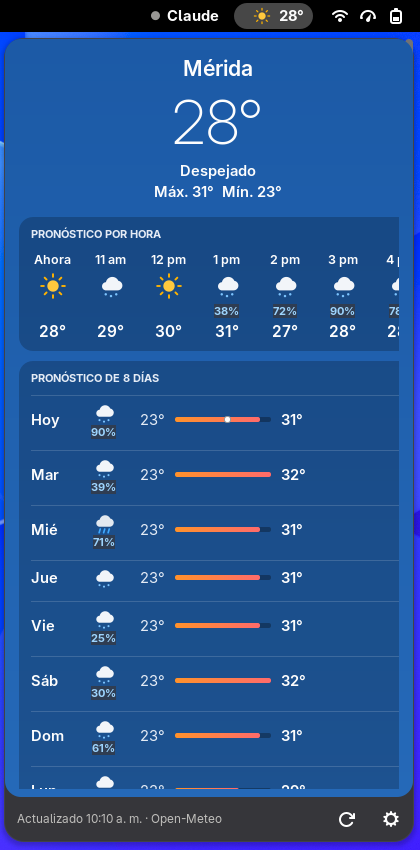
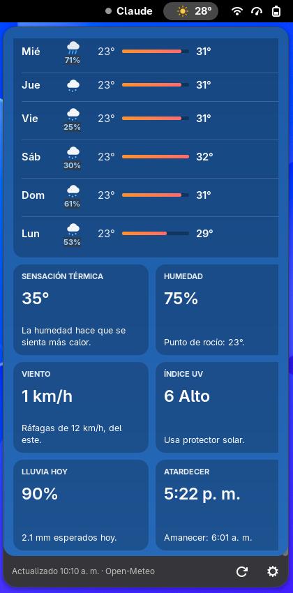
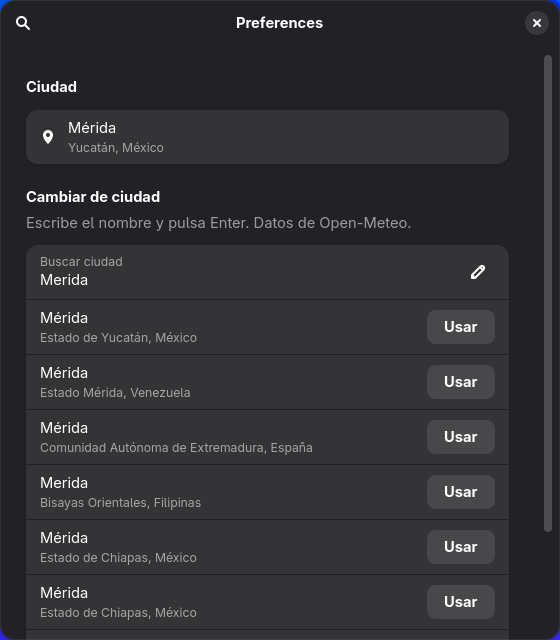

# Clima

Extensión de GNOME con el clima de tu ciudad en la barra de arriba: un ícono de color (sol, luna,
nubes, lluvia, tormenta…) y los grados. Al hacer clic se abre una ventana al estilo de Clima de
Apple, con pronóstico por hora, de 8 días y detalles.

Los datos son de [Open-Meteo](https://open-meteo.com/): gratis, sin cuenta y sin llave.


| Ventana | Detalles | Elegir ciudad |
|---|---|---|
|  |  |  |

## Qué hace
- **En la barra:** ícono de color según el tiempo (de noche cambia a luna) y la temperatura.
- **Al hacer clic:**
  - Ciudad, temperatura grande, cómo está el cielo y la máxima y mínima de hoy.
  - **Pronóstico por hora** (24 horas): hora, ícono, probabilidad de lluvia si pasa de 20 % y
    temperatura. Se mueve de lado con la rueda del ratón.
  - **Pronóstico de 8 días**: ícono, probabilidad de lluvia, mínima, máxima y una barra de color
    con el rango (azul frío → rojo calor). En la de hoy, un punto blanco marca la temperatura de ahora.
  - **Detalles:** sensación térmica, humedad y punto de rocío, viento y ráfagas, índice UV,
    probabilidad y milímetros de lluvia, y el siguiente amanecer o atardecer.
  - El fondo cambia de color según el tiempo: azul de día, azul noche, gris si está nublado, más
    oscuro con lluvia o tormenta.
  - Abajo: a qué hora se actualizó, botón para actualizar y botón para cambiar de ciudad.
- Se actualiza cada 15 minutos, y al abrir la ventana si los datos tienen más de 10 minutos.
- Si no hay internet, lo dice y da un botón **Reintentar**.
- Las horas salen en formato de 12 o 24 horas, igual que el reloj de tu GNOME.

## Elegir tu ciudad
De fábrica es Mérida, Yucatán. Para cambiarla, abre la ventana del clima y pulsa el engrane (o
`gnome-extensions prefs clima@dimitrimednov.github.io`). Escribe el nombre, pulsa Enter y elige la
correcta con **Usar**.

## Posición en la barra
Va justo a la derecha de [Panel Claude](https://github.com/DimitriMedNov/panel-claude) si lo tienes;
si no, al principio del lado derecho de la barra.

## Instalar
Requisitos: GNOME Shell 48 a 51 (Wayland o X11) y `glib-compile-schemas` (viene con GLib).
Probada en CachyOS (Arch) con GNOME 51.

```bash
git clone https://github.com/DimitriMedNov/clima.git
cd clima
./install.sh
```

No pide sudo: todo queda en tu usuario (`~/.local/share/gnome-shell/extensions/`).
Después **cierra sesión y vuelve a entrar**. En Wayland, GNOME solo carga extensiones nuevas o
actualizadas al iniciar sesión (bloquear la pantalla no basta).

Para actualizar: `git pull` y otra vez `./install.sh` (y cerrar sesión).
Para quitarla: `./install.sh --quitar`.

## Problemas comunes
- **No la veo después de instalar.** Cierra sesión y vuelve a entrar. Si sigue sin salir, revisa que
  esté activa: `gnome-extensions info clima@dimitrimednov.github.io` debe decir `State: ACTIVE`.
- **Dice "No pude traer el clima".** Revisa tu conexión a internet y pulsa **Reintentar**.
- **Ver los errores:** `journalctl --user -b -o cat /usr/bin/gnome-shell | grep -i clima`.

## Privacidad
Solo manda a Open-Meteo las coordenadas de la ciudad que elegiste. No usa tu ubicación real ni
guarda nada fuera de los ajustes de GNOME.

## Licencia
[MIT](LICENSE). Los íconos del clima son dibujos propios de este proyecto, también MIT.
